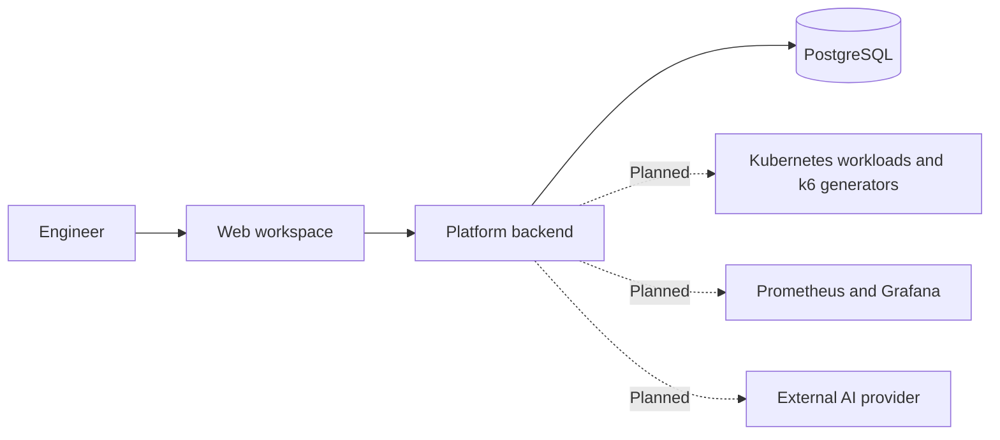

<div align="center">

# Loadpilot

### Adaptive Load Testing and Kubernetes Resource Optimization

**A thesis project combining performance evidence, bounded experiments, and AI assistance.**

</div>

## Overview

Loadpilot is a web platform being developed to help engineers answer two questions: **How much load can this application handle?** and **Which CPU and replica configuration meets its performance goals?**

The intended workflow brings scenario authoring, load testing, resource comparisons, and result analysis into one workspace. Engineers define performance goals, review a k6 script, and run controlled experiments against an authorized Kubernetes workload. Loadpilot will use the collected evidence to estimate capacity and recommend the best configuration it has tested within the chosen budget.

**Status: early development.** The repository currently contains the frontend workspace and sign-in preview, plus the backend foundation. Browser authentication and experiment execution are still planned.

## Features

| Area | Capability | Status |
| --- | --- | --- |
| Workspace | Navigation and previews for targets, scenarios, experiments, comparisons, and settings | Implemented |
| Sign-in | Login interface with shared form controls | Preview; no authentication or session |
| Backend foundation | Health endpoint, protected status API, and database migration baseline | Implemented foundation |
| Target management | Register applications and diagnose Kubernetes and monitoring connections | Planned |
| Scenario authoring | Create, version, validate, and approve manual or AI-drafted k6 scripts | Planned |
| Adaptive testing | Adjust load within defined bounds to find an observed capacity interval | Planned |
| Resource optimization | Compare CPU and replica configurations at the same required load | Planned |
| AI assistance | Draft scenarios and explain results using recorded evidence | Planned |
| Reporting | Experiment history, comparisons, and reproducible exports | Planned |
| Distributed execution | Coordinate multiple load generators and aggregate valid evidence | Planned |

## Intended workflow

1. **Define the target:** select an authorized application and its Kubernetes workload.
2. **Set the goals:** choose load bounds, latency/error thresholds, resource limits, and an experiment budget.
3. **Review the scenario:** write or generate a k6 script, validate it, and approve its exact content.
4. **Measure capacity:** run bounded tests and evaluate whether the available evidence meets the goals.
5. **Compare configurations:** test CPU and replica candidates under the same required load.
6. **Review the results:** inspect measurements, recommendations, and AI explanations; verify restoration of the original workload settings.

These steps describe the planned product experience; the current interface provides previews.

## Architecture

The platform is designed around one web frontend and one modular backend. The backend will coordinate experiments, preserve their evidence, and connect to a separate Kubernetes laboratory.



The frontend, backend foundation, and database baseline exist today. Experiment orchestration, measurements, optimization, and AI integrations are planned backend capabilities.

## Technology

| Layer | Technology |
| --- | --- |
| Frontend | Next.js 16, React 19, TypeScript |
| Backend | Java 21, Spring Boot 3.5, Spring Security |
| Persistence | PostgreSQL 16, Flyway |
| Hosting | Nginx, systemd, static frontend and Java application |
| Planned load execution | Grafana k6, Kubernetes Java Client |
| Planned observability | Prometheus, Grafana, Micrometer; OpenTelemetry where target instrumentation is available |
| Planned AI integration | Spring AI with an external provider |

## Experiment principles

- **Evidence first:** missing, stale, or invalid required measurements produce **Insufficient data**.
- **Comparable results:** resource candidates must meet performance goals at the same required load.
- **Bounded execution:** experiments use approved scripts, explicit limits, and finite budgets.
- **Workload recovery:** original controlled CPU and replica settings must be restored after experiments.
- **Advisory AI:** AI proposes scripts and explains evidence; deterministic rules govern verdicts and execution.

The initial optimization scope covers one Deployment/container's CPU and replicas, with memory fixed. Recommendations describe tested candidates and do not permanently promote a configuration.

## Project structure

```text
apps/web/       Web workspace and UI components
apps/platform/  Backend foundation and database migrations
infra/          Native hosting configuration
scripts/        Deployment tooling
.github/        Build and deployment workflow
```

## Roadmap

The next milestones are to verify the frontend and backend foundation, connect real authentication, and implement target management and scenario approval. Later milestones add bounded execution and recovery, reliable measurements, adaptive capacity testing, resource optimization, AI assistance, reporting, and distributed generators.

A separate six-service example application and thesis evaluation follow platform acceptance.
